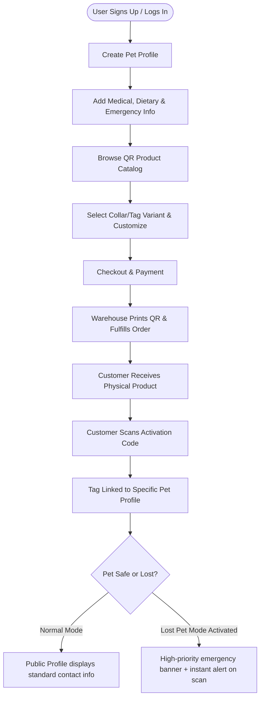
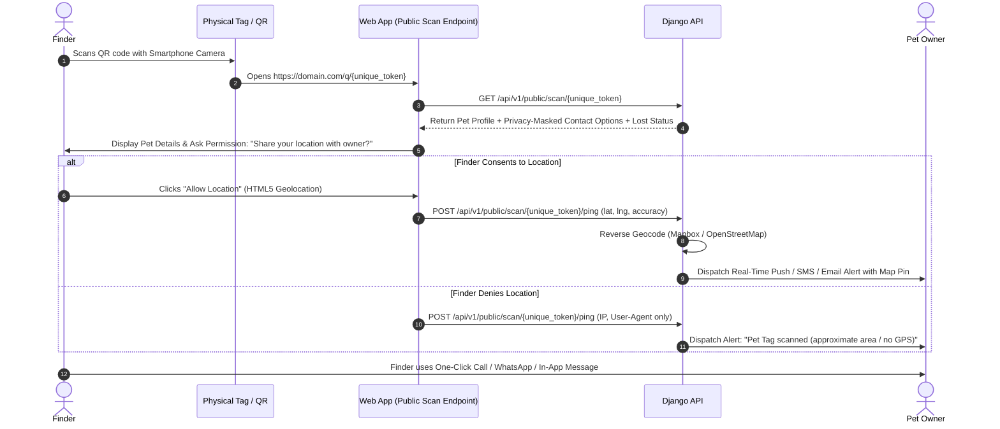
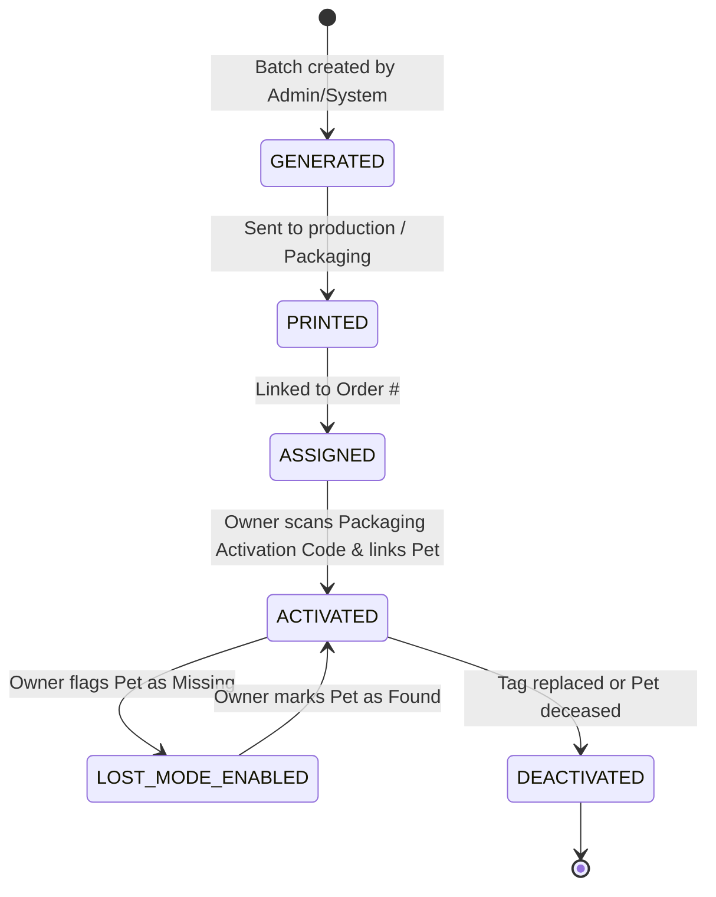
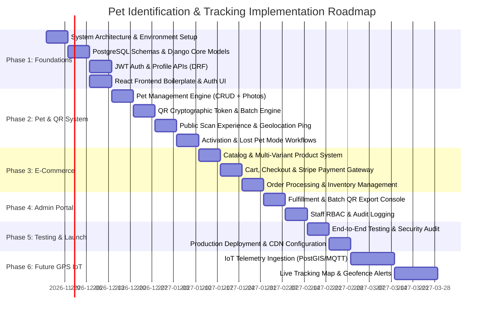
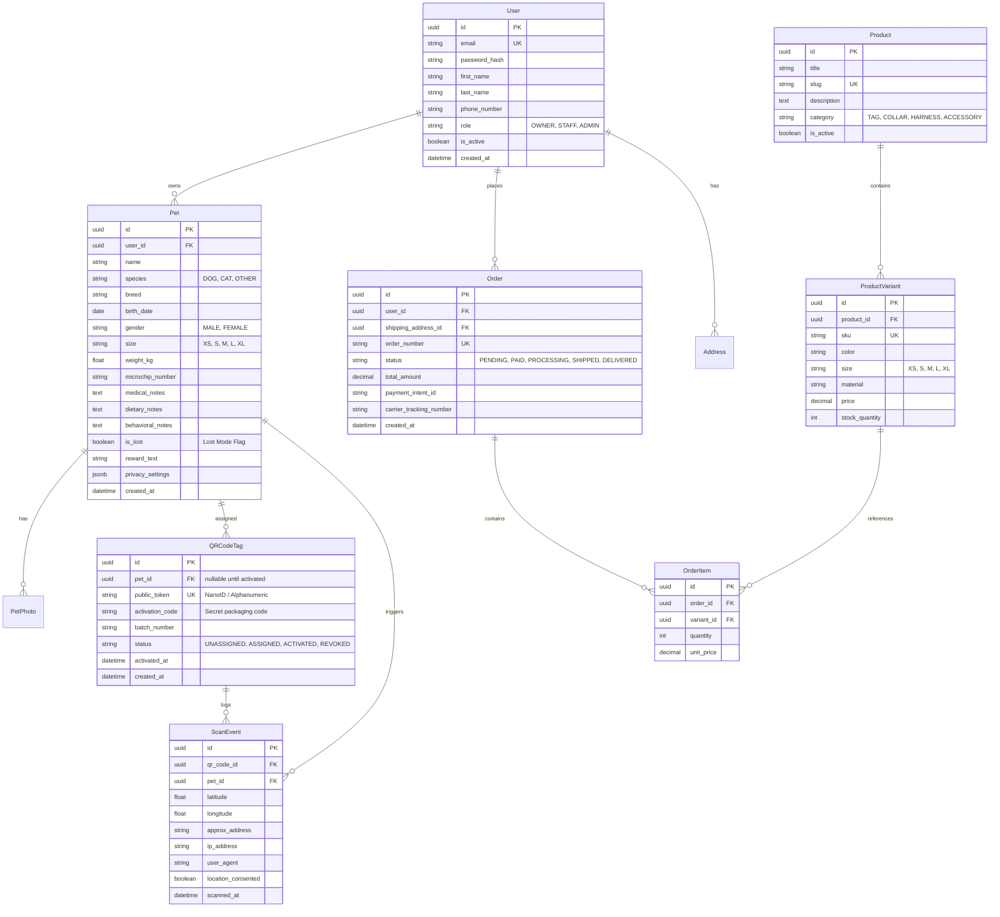

# Pet Identification & Tracking Platform — Master Blueprint & Implementation Roadmap

> **Document Version**: 1.0  
> **Status**: Approved for Scaffolding & Development  
> **Target Stack**: React (TypeScript/Vite/Tailwind) + Python (Django/DRF/PostgreSQL/PostGIS/Celery/Redis)

---

## 1. Executive Summary & Product Vision

The **Pet Identification & Tracking Platform** is an end-to-end pet safety ecosystem designed to bridge physical identification products with digital emergency response tools.

### Core Value Proposition
- **For Pet Owners**: Peace of mind through smart identification tags, instantaneous finder alerts with reverse geolocation, customizable public privacy profiles, and a unified health/identification record.
- **For Finders**: Zero-friction discovery. No mobile app download required; any smartphone camera scanning the tag instantly opens a lightweight, mobile-responsive page with critical pet info and one-touch contact buttons.
- **For the Business**: Direct-to-Consumer (D2C) hardware sales (QR collars, tags, custom engraved accessories), recurring subscription models (for premium lost-pet broadcasting and future GPS services), and brand loyalty.
- **Evolutionary Trajectory**: Start with **passive QR-code identification products** (ultra-low production cost, zero battery overhead, maximum reliability), and architect the platform to seamlessly integrate **active GPS/cellular/BLE IoT tracking devices** in subsequent phases.

---

## 2. End-to-End Business Workflows & State Machines

### 2.1 The Customer & Pet Lifecycle Workflow


### 2.2 The Finder & Lost Pet Workflow (Critical Core Loop)


### 2.3 QR Code Physical Lifecycle & State Machine
Each QR code has a distinct lifecycle to prevent unauthorized access or reuse:


---

## 3. Detailed Functional Modules Specification

### Module 1: Authentication & User Account Management
- **User Roles**: `Pet Owner`, `Support Staff`, `Inventory / Fulfillment Manager`, `Superadmin`.
- **Auth Protocol**: JWT (Access Token + Refresh Token via HTTP-only secure cookies or Authorization headers).
- **Features**:
  - Email & password registration with email verification.
  - Social authentication (Google OAuth2).
  - Password recovery / reset workflows.
  - Multi-profile management (primary owner + secondary co-owners / emergency contacts).
  - Granular privacy settings (choose what phone numbers, emails, or addresses are visible on public scans).

### Module 2: Pet Profile & Health Record Management
- **Pet Attributes**:
  - Name, Species (Dog, Cat, etc.), Breed, Gender, Spayed/Neutered status.
  - Date of Birth / Approximate Age, Weight, Size category (XS, S, M, L, XL).
  - Microchip ID, License/Rabies Tag ID.
  - High-resolution gallery (Avatar, distinguishing physical marks, full body).
- **Critical Medical & Dietary Alerts**:
  - Medications required (e.g., "Daily Insulin dependent").
  - Behavioral warnings (e.g., "Extremely shy - do not chase", "Dog-friendly").
  - Veterinarian details and clinic emergency phone.

### Module 3: E-Commerce, Product Catalog & Smart Recommendations
- **Catalog Structure**:
  - Categories: QR Smart Tags, QR Collars, QR Harnesses, Replacement Tags, Accessories.
  - Multi-variants: Color, Material (BioThane, Stainless Steel, Silicone, Fabric), Size.
- **Smart Sizing & Fit Engine**:
  - Recommends appropriate collar/harness sizes based on the user's registered pet weight, breed, and neck circumference.
- **Shopping Flow**:
  - Guest & Authenticated Cart (synced via Zustand & backend persistent cart).
  - Stripe / Payment Gateway checkout integration.
  - Order breakdown (Subtotal, Shipping, Tax, Discounts).
  - Real-time address validation.

### Module 4: Order Fulfillment, Shipping & Batch QR Provisioning
- **Batch QR Generator Engine**:
  - Admin/Production creates batch runs (e.g., Batch #104 - 5,000 tags).
  - System generates cryptographically secure, high-entropy unique tokens (10-12 alphanumeric characters or NanoIDs).
  - Generates print-ready vector/SVG QR codes embedded with `https://app.yourdomain.com/q/{token}`.
  - Produces an accompanying secret **Activation Code** (printed inside packaging or scratch-off card).
- **Order Tracking & Shipping**:
  - Statuses: `Pending` -> `Paid` -> `In Production (Printing)` -> `Shipped` -> `Delivered`.
  - Carrier tracking numbers and automated shipping notification emails.

### Module 5: QR Activation & Binding
- Upon product arrival, the customer navigates to the app or scans the packaging QR:
  1. Authenticates into their account.
  2. Selects which pet profile to attach the tag to.
  3. Enters the secret **Activation Key** from the physical package.
  4. Tag status transitions to `ACTIVATED`.

### Module 6: Finder Portal (Public QR Scan Experience)
- **Zero-Barrier Mobile Web App**:
  - Lightning-fast lightweight React/SSR page optimized for slow 3G/4G connections.
  - No login or registration required for the finder.
  - Displays pet photo, name, owner contact actions (Call, SMS, WhatsApp, In-App Message).
  - Critical medical alerts highlighted in bold red badges.
- **Geolocation Ping & Owner Alerting**:
  - Friendly browser prompt: *"Help reunite [Pet Name] with their owner by sharing your current location"*.
  - Sends coordinates to backend -> Reverse-geocoded to street address -> Sent to owner within seconds via Push Notification & Email.
  - If denied: Logs timestamp, IP address, and rough ISP city.

### Module 7: Lost Pet Mode & Community Alerting
- Toggleable switch on owner's dashboard:
  - Changes the public QR profile to emergency high-contrast alert design.
  - Option to display a "Reward Offered" badge.
  - Generates a 1-click printable "Lost Pet Poster" (PDF) with pet photo, details, and dynamic QR code.
  - Broadcast notification readiness (future integration with local pet community/shelters).

### Module 8: Admin & Staff Management Portal
- **Dashboard Metrics**: Active pets, registered tags, orders pending fulfillment, lost pet alerts, scan frequency heatmap.
- **Inventory & Batch Operations**: Batch QR export (PDF/ZIP of SVGs for tag manufacturers), stock adjustments.
- **Order Processing**: Mark orders as printed, dispatched, or delivered; attach tracking numbers.
- **Security & Moderation**: Audit logs, ban abusive accounts, override tag associations.

---

## 4. Phase-Wise Implementation Roadmap



### Phase 1: Foundation, Infrastructure & Core Authentication
- **Backend**:
  - Django 5 project structure with modular apps (`accounts`, `pets`, `products`, `orders`, `qrcodes`, `notifications`).
  - PostgreSQL database connection with PostGIS extension.
  - Celery + Redis worker configuration for async tasks.
  - S3 / Cloudflare R2 integration for media storage (Boto3 / django-storages).
  - Custom User Model with JWT authentication (access & refresh tokens).
- **Frontend**:
  - Vite + React 18/19 + TypeScript + Tailwind CSS setup.
  - TanStack Query (React Query) API client setup + Axios interceptors for token refresh.
  - Zustand auth store with persistent login state.
  - Responsive design system (Typography, Buttons, Modals, Forms, Alerts).

### Phase 2: Pet Profiles, QR Code Engine & Finder Workflow
- **Backend**:
  - Pet models with media attachments, medical alerts, and privacy rules.
  - QR Code generator utility producing SVG/PNG codes with high-entropy public UUIDs/NanoIDs.
  - QR Tag assignment and packaging activation key verification.
  - Public scan endpoint (`/api/v1/public/scan/<token>/`) with rate-limiting and privacy filters.
  - Scan logging model (IP, Geolocation coordinates, User-Agent, Timestamp).
  - Celery notification task sending immediate Email/Push alert to pet owner upon scan.
- **Frontend**:
  - Pet dashboard: Add/Edit pet, photo upload with cropping, medical condition tags.
  - Lost Pet Mode toggle with emergency status banner.
  - Public Scan page (`/q/:token`): ultra-fast responsive landing page, one-click contact drawer, HTML5 geolocation prompt.
  - Tag activation wizard for newly delivered products.

### Phase 3: E-Commerce, Product Variants & Checkout
- **Backend**:
  - Product catalog models (Categories, Products, Variants: Size, Color, Material, Price, SKU, Stock).
  - Cart and Order models with state transitions (`Pending`, `Paid`, `Processing`, `Shipped`, `Delivered`).
  - Stripe Checkout / Payment Intent webhook integration.
  - Automatic QR inventory reservation upon order placement.
- **Frontend**:
  - Product catalog with filters (by pet size, breed, material).
  - Product detail page with dynamic variant selection and collar size guide.
  - Zustand cart drawer and multi-step checkout (Address -> Shipping -> Stripe Payment).
  - Order history and tracking timeline view.

### Phase 4: Admin Dashboard & Order Fulfillment Console
- **Admin Capabilities**:
  - Batch QR Generator: Create 100 to 10,000 unique QR tokens at once, export as printable vector sheet or ZIP for manufacturers.
  - Order fulfillment station: Scan physical tag packaging to bind to an order, generate shipping labels.
  - Role-based permissions: Restrict support staff from financial/admin actions.
  - Metrics & Analytics: Active pets, scan events, sales conversion, lost pet resolution times.

### Phase 5: Hardening, Polish & Production Launch
- Security review: Rate limiting on public scan endpoints, CORS validation, CSRF protection, data sanitization.
- Performance optimization: Lazy loading, image optimization (WebP/AVIF), edge CDN caching for static public QR profiles.
- Notification multi-channel support: SendGrid/Resend (Email) + Twilio (SMS alerts).
- Production deployment scripts (Docker, Nginx, Gunicorn, PostgreSQL, Redis).

### Phase 6: Future GPS & IoT Tracking Integration
- **Architectural Readiness**:
  - `Device` model for active GPS trackers (IMEI, SIM number, battery level, firmware version).
  - `DeviceTelemetry` model with PostGIS `PointField(geography=True)` for sub-second coordinate storage.
  - Real-time ingestion: Lightweight HTTP or MQTT webhook broker.
  - Interactive map dashboard using Leaflet / MapLibre with live vehicle/pet icon movement, path history trail, and circular/polygon geofencing alerts (enter/exit notifications).

---

## 5. System Architecture & Technology Stack

```
                        ┌────────────────────────────────────────────────────────┐
                        │                   CLIENT LAYER                         │
                        │                                                        │
                        │   ┌─────────────────────┐    ┌─────────────────────┐   │
                        │   │   Owner Dashboard   │    │ Public Finder Page  │   │
                        │   │ (React + TS + Vite) │    │  (Lightweight /q/)  │   │
                        │   └──────────┬──────────┘    └──────────┬──────────┘   │
                        └──────────────┼──────────────────────────┼──────────────┘
                                       │ HTTPS / REST API         │
                        ┌──────────────▼──────────────────────────▼──────────────┐
                        │                  API GATEWAY & LOAD BALANCER           │
                        │                       (Nginx / Cloudflare)             │
                        └──────────────────────────────┬─────────────────────────┘
                                                       │
                        ┌──────────────────────────────▼─────────────────────────┐
                        │                   BACKEND LAYER                        │
                        │                                                        │
                        │           Django 5.x + Django REST Framework           │
                        │   ┌───────────────┐ ┌───────────────┐ ┌────────────┐   │
                        │   │ Accounts/Auth │ │   Pets & QR   │ │ E-Commerce │   │
                        │   └───────┬───────┘ └───────┬───────┘ └─────┬──────┘   │
                        └───────────┼─────────────────┼───────────────┼──────────┘
                                    │                 │               │
       ┌────────────────────────────┼─────────────────┼───────────────┴──────────┐
       │                            ▼                 ▼                          │
┌──────▼───────┐           ┌──────────────────┐  ┌────────────────┐       ┌──────▼──────┐
│  Redis Cache │           │    PostgreSQL    │  │ Celery Workers │       │ S3 Storage  │
│  & Channels  │           │   with PostGIS   │  │ (Async Alerts, │       │  (Photos,   │
│ (Sessions/GPS)           │ (Relational Data)│  │  QR Batches)   │       │  QR SVGs)   │
└──────────────┘           └──────────────────┘  └───────┬────────┘       └─────────────┘
                                                         │
                                         ┌───────────────┴───────────────┐
                                         │  External Notification APIs   │
                                         │  (Twilio SMS, Resend/SendGrid)│
                                         └───────────────────────────────┘
```

### Complete Stack Specification
| Layer | Technology | Justification |
| :--- | :--- | :--- |
| **Frontend Framework** | React 18+ with TypeScript | High performance, strict type safety for mission-critical medical/order data. |
| **Build Tool & Styling** | Vite + Tailwind CSS | Sub-second HMR, optimized build bundles, atomic utility-first responsive styling. |
| **State Management** | Zustand | Minimalist, zero-boilerplate state store for user sessions, cart, and modals. |
| **Data Fetching** | TanStack Query v5 | Automatic caching, background refetching, mutation states, optimistic updates. |
| **Backend Core** | Python 3.12 + Django 5 + DRF | Battle-tested, secure ORM, modular architecture, built-in admin, rapid API development. |
| **Database** | PostgreSQL 16 + PostGIS | Enterprise-grade relational integrity + native spatial/geographic querying for scan & GPS coordinates. |
| **Task Queue & Broker** | Celery + Redis | Decouples heavy operations (QR image generation, email/SMS dispatch, geocoding) from HTTP requests. |
| **Authentication** | SimpleJWT (RFC 7519) | Stateless, secure, easily portable between web and future native mobile apps. |
| **Asset Storage** | AWS S3 or Cloudflare R2 | Reliable, scalable object storage for pet galleries and printable vector QR codes. |
| **Maps & Geolocation** | Leaflet / MapLibre GL | Open-source, flexible, lightweight mapping for lost pet scan pins and future GPS breadcrumbs. |

---

## 6. Comprehensive Database Schema & ERD



---

## 7. Security, Privacy & Compliance Architecture

1. **Owner Privacy Shield**:
   - Pet owners have granular control over public disclosure. Options to show:
     - `Phone Number`: Direct call button vs. Masked proxy call vs. In-app web form.
     - `Owner Full Name`: Display first name only or alias.
     - `Address`: Always hidden by default; option to show city/neighborhood only.
     - `Medical Conditions`: Critical alerts (e.g. Diabetic) can be highlighted without exposing entire vet records.
2. **Rate Limiting & Anti-Scraping**:
   - Public scan endpoint `/q/{token}` is protected by Django Ratelimit (e.g. max 10 requests per minute per IP) to prevent automated token enumeration attacks.
3. **Location Privacy & Consent (GDPR / CCPA Compliant)**:
   - Geolocation is strictly **opt-in**. The browser requests permission with transparent context explaining it sends the location to the owner.
   - If denied, the system falls back to coarse IP-based geocoding without blocking the finder from viewing contact information.
4. **Activation Code Verification**:
   - Prevents unauthorized hijacking: A physical tag cannot be reassigned without the secret activation key printed on the physical packaging.
